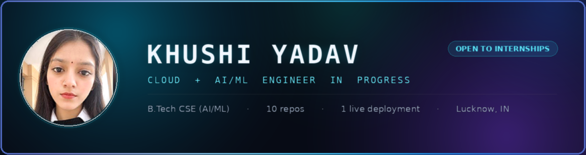

 

Cloud Engineer in progress · B.Tech CSE (AI & ML)
I build AI-powered cloud tools — cost visibility, observability and automation.
📍 Lucknow, India &nbsp;·&nbsp; 🎯 Open to Cloud / DevOps / Platform internships

<!-- TODO: apna Instagram username daalein -->

<!-- TODO: apna HackerRank username daalein -->

<!-- TODO: portfolio ka live link daalein (repo ka description me URL) -->

☁️ About Me
•
Cloud: AWS (EC2, S3, IAM, Lambda, CloudWatch), Linux administration, networking fundamentals — VPC, subnets, security groups, DNS, load balancing.
•
AI/ML: Python, Pandas, scikit-learn, LLM APIs — and the infrastructure that makes models run in production.
•
Focus right now: the two problems every cloud team is fighting in 2026 — what AI and Kubernetes actually cost, and how to observe and automate the systems that run them.
•
Goal: build production-grade cloud tooling, ship it live, and grow into a Cloud / Platform Engineer role.
🚀 Featured Projects
🔴 Live now — DhwaniSetu
An ML model, deployed and running on the internet — not a notebook.
DhwaniSetu listens to the sound of a tap on concrete and classifies it as Normal / Warning / Danger. It isolates the tap from the recording, extracts FFT spectrum, MFCC and ring-time features, and runs a Random Forest classifier — then serves the verdict through a phone-friendly web app in English and Hindi.
Python · Streamlit · scikit-learn · Random Forest · FFT / MFCC · librosa

What it proves: audio feature engineering, model training with cross-validation, a documented limitation section (the model is trained on synthetic sounds — stated openly, not hidden), and end-to-end deployment.
More projects
<table>
<tr>
<td width="33%" valign="top">
🤖 Cloud-Native AI Pipeline (WIP)
 
Multi-agent system that maps a student's skills against real job requirements and returns a gap report.
Python · LLM APIs
Repository
</td>
<td width="33%" valign="top">
📊 Cloud Data Automation
 
Automates grocery billing with Pandas and writes clean CSV reports — repeatable data workflows, not manual sheets.
Python · Pandas
Repository
</td>
<td width="33%" valign="top">
🐍 Python Foundations
 
Daily Python practice — data structures, OOP, file handling, problem solving. 100+ commits and counting.
Python
Repository
</td>
</tr>
</table>
🚧 Currently Building
<table>
<tr>
<td width="100%">
`AgentCost` — per-agent LLM cost attribution (in progress)
Every team using LLM APIs knows the bill is growing and nobody can say which feature or agent is spending it. AgentCost sits in front of model calls, tags every request, and reports cost per user, per agent, per task with budget alerts.
Python · FastAPI · PostgreSQL · Docker · Terraform · AWS
•
[x] Problem definition + data model
•
[ ] Gateway + cost calculator
•
[ ] Dashboard + budget alerts
•
[ ] Terraform deploy on AWS
</td>
</tr>
</table>
Learning now: Kubernetes (CKA track) · Terraform · GitHub Actions · Prometheus & Grafana · OpenTelemetry
🛠️ Tech Stack
Area
Tools
Cloud
AWS · EC2 · S3 · IAM · Lambda · CloudWatch · VPC
DevOps
Docker · Terraform · GitHub Actions · Nginx · Git
Systems
Linux · Bash · Networking (TCP/IP, DNS, HTTP, Load Balancing)
Languages
Python · JavaScript · HTML · CSS · SQL
AI / ML
Pandas · NumPy · scikit-learn · LLM APIs · Prompt & agent design
Data
PostgreSQL · CSV / ETL with Pandas
Tools
VS Code · Postman · Jupyter · Git & GitHub
🚀 Featured Projects
<table>
<tr>
<td width="33%" valign="top">
🐍 Python Foundations
 
Daily Python practice — data structures, OOP, file handling, problem solving. 100+ commits and counting.
Python
Repository
</td>
<td width="33%" valign="top">
📊 Cloud Data Automation
 
Automates grocery billing with Pandas and writes clean CSV reports — my first step into scripting real, repeatable data workflows.
Python · Pandas
Repository
</td>
<td width="33%" valign="top">
🤖 Cloud-Native AI Pipeline (WIP)
 
Multi-agent system that maps a student's skills against real job requirements and returns a gap report.
Python · LLM APIs
Repository
</td>
</tr>
</table>
<!--
TEMPLATE — jab AgentCost live ho jaye, tab ise copy karke upar wali table me add karein:
<td width="33%" valign="top">
💰 AgentCost
 
Per-agent LLM cost attribution: tracks token spend per user, agent and task, with budget alerts.
 
Live: 1,200 calls tracked · ₹X/day visibility
FastAPI · PostgreSQL · Docker · Terraform · AWS
Live Demo · Repository
</td>
-->
📈 GitHub Stats

🎓 Certifications & Learning Path
Status
Certification
🎯 Next
AWS Certified Solutions Architect – Associate (SAA-C03)
📚 Planned
Terraform Associate (HashiCorp)
📚 Planned
CKA – Certified Kubernetes Administrator
🤝 Open Source & Collaboration
•
Contributed to team repositories (Devdoots_Python, Devdoots_VyomAcre) — pull requests, reviews and feature work.
•
Comfortable with Git workflows: branches, PRs, code review, resolving conflicts.

Let's build something on the cloud

  
<i>"Code is just logic in disguise. My goal is to build cloud-native software that scales globally."</i>

<!--
OPTIONAL UPGRADE — contribution snake animation.
Isko on karne ke liye ek GitHub Action chahiye (.github/workflows/snake.yml).
Jab ready ho, tab neeche wali 3 lines uncomment karein aur workflow file add karein:

  

-->
